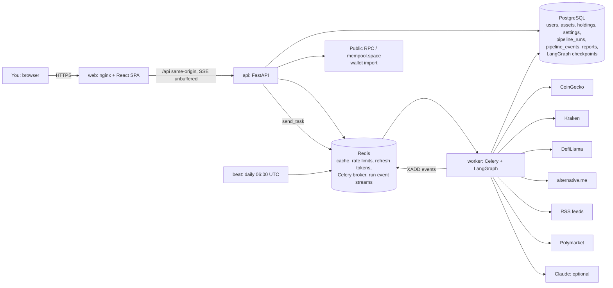
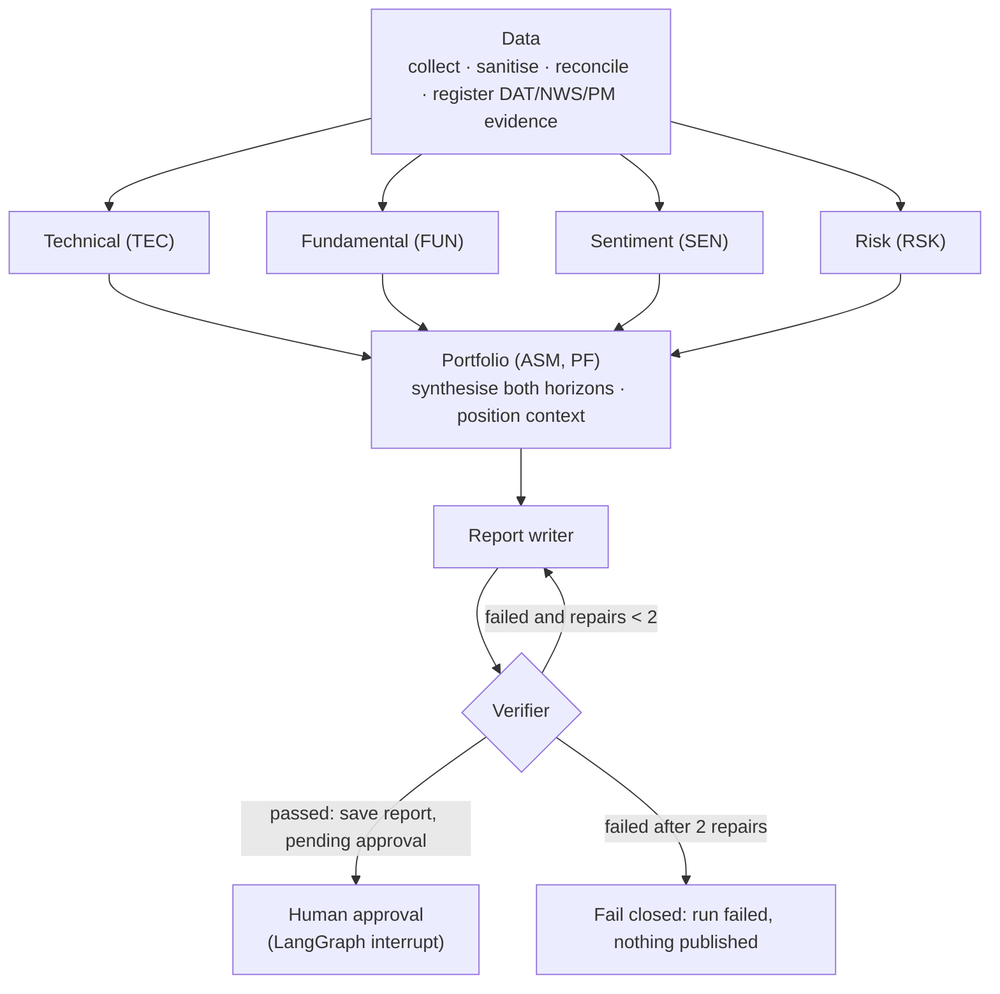
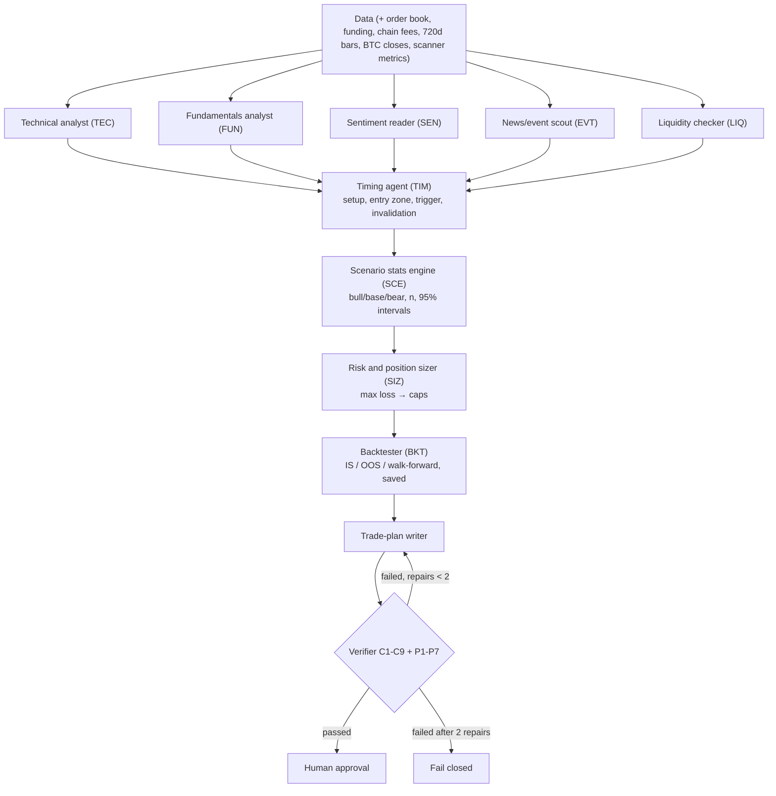

# Lodestar architecture

## 1. Design goals

1. **Trustworthy before clever.** Every number comes from a named provider or from deterministic code. Agents choose what to look at and explain it. They never compute, score or predict, and a verifier decides what a human sees.
2. **Fail closed, degrade gracefully.** A report that cannot be verified is never published. A missing optional source is recorded as a data gap. An unavailable model falls back to deterministic agents.
3. **Observable.** Every step streams its status, inputs, outputs and evidence ids, and is stored as an audit trail.
4. **Read-only.** No private keys, no signing, no trading. Wallet import reads public addresses only.
5. **Replaceable parts.** Providers, the LLM, the job queue, the workflow engine and the event bus each sit behind a port.
6. **Cheap to run for one person.** One Postgres, one Redis, a few small processes; demo mode needs no keys and no network.

## 2. System context



## 3. Clean Architecture layers

```
backend/src/lodestar/
├── domain/                 Pure business rules. No I/O, no frameworks.
│   ├── models.py               entities and value objects (Asset, MarketSnapshot, Candle, RunStatus, ...)
│   ├── indicators.py           SMA/EMA/RSI/MACD/Bollinger/volatility/drawdown (+ series for charts)
│   ├── evidence.py             Evidence, EvidenceRegistry (namespaced ids), EvidenceBundle
│   ├── claims.py               Claim + ClaimTag (fact/calculation/interpretation/scenario/assumption)
│   ├── scoring.py              analyst signal rules, per-horizon risk model, synthesis
│   ├── report.py               ReportDraft, DISCLAIMER
│   ├── verification.py         the verifier (claim rules C1-C9, report rules R1-R3)
│   ├── reconciliation.py       cross-provider price reconciliation
│   ├── portfolio.py            weights, concentration (HHI), blended risk, portfolio volatility
│   └── addresses.py            public-address validation, private-key / seed-phrase detection
├── application/            Use cases. Depends on domain + ports only.
│   ├── ports.py                Protocols: providers, repositories, JobQueue, WorkflowEngine, RunEventBus, ...
│   ├── pipeline/               the agent pipeline (framework-free)
│   │   ├── nodes.py                graph steps + instrumentation + repair routing
│   │   ├── react.py                ReAct loop, Toolkit, ScriptedPolicy
│   │   ├── analysts/               technical, fundamental, sentiment, risk (+ base)
│   │   ├── data_step.py            collection, sanitising, reconciliation, evidence registration
│   │   ├── portfolio_step.py       horizon synthesis + position context
│   │   ├── writer.py               ReportWriter port + deterministic writer
│   │   ├── events.py, approval.py, state.py
│   ├── services/               assets, runs, reports, portfolio, overview, settings
│   ├── importers.py, exports.py, codec.py, sanitize.py, auth.py
├── infrastructure/         Adapters implementing the ports.
│   ├── providers/              coingecko, kraken, defillama, sentiment, news, polymarket, wallets, demo
│   ├── llm/                    Claude analyst policy, Claude writer, prompts
│   ├── orchestration/          LangGraph graph + engine, Postgres checkpointer
│   ├── queue/                  Celery app + JobQueue adapters
│   ├── events/                 Redis Streams event bus (+ in-memory)
│   ├── db/, cache/, export/ (PDF), security/, http.py
│   └── container.py            composition root (the only place that knows concrete classes)
└── interfaces/             Delivery mechanisms.
    ├── http/                   FastAPI app, routers, SSE, middleware, problem+json errors
    ├── workers/tasks.py        Celery tasks (run, resume, daily)
    └── cli.py                  seed, run <coin>, daily
```

**Dependency rule:** arrows point inward. `domain` imports nothing from the project; `application` imports `domain` and its own ports; `infrastructure` and `interfaces` depend on both. The pipeline nodes never import LangGraph: the human-approval `interrupt` is injected as an `ApprovalGate`, and the graph wiring lives in `infrastructure/orchestration`.

| SOLID | Where |
|---|---|
| Single responsibility | Data step collects; analysts analyse; the portfolio step synthesises; the writer explains; the verifier verifies |
| Open/closed | A new analyst is a new `Analyst` subclass plus one graph node; a new provider is a new adapter |
| Liskov | `ScriptedPolicy` / `ClaudeAnalystPolicy`, `TemplateReportWriter` / `ClaudeReportWriter`, demo / live providers are interchangeable |
| Interface segregation | Small ports (`ExchangeProvider`, `ReferencePriceProvider`, `RunEventBus`, ...) |
| Dependency inversion | Use cases depend on `ports.py`; `container.py` wires adapters |

## 4. The agent pipeline



The graph is compiled by LangGraph with a **Postgres checkpointer**, keyed by run id. The four analysts run in the same super-step, so in parallel. Parallel writes to `evidence` and `analysts` use merge reducers. Graph state is plain JSON (the market-data bundle is encoded by `application/codec.py`), so checkpoints are safe to reload in any process.

### Steps

| Step | Does (all computation in code) | Evidence namespace |
|---|---|---|
| **Data** | Snapshot + 365d history (required); exchange candles + ticker, reference price, supply, liquidity, Fear & Greed, chain TVL, headlines, prediction markets (optional). Sanitises untrusted text, reconciles prices, registers evidence | `DAT`, `NWS`, `PM` |
| **Technical** | Trend vs 20/50/200-day averages, RSI, MACD, Bollinger, volatility, volume confirmation, support/resistance, 1-year trend | `TEC` |
| **Fundamental** | Size and rank, circulating ratio, FDV/market cap, turnover, liquidity depth and spreads, chain TVL | `FUN` |
| **Sentiment** | Fear & Greed extremes, headline counts, Polymarket odds (context only) | `SEN` |
| **Risk** | Itemised risk **per horizon**: volatility, drawdown, liquidity, size, dilution, sentiment extremes, recent move, price-source disagreement | `RSK` |
| **Portfolio** | Combines analyst signals into short-term and long-term scores, stances and confidence; adds what you hold, value, weight, P&L and concentration (no sizing advice) | `ASM`, `PF` |
| **Report writer** | Explains the bundle as tagged claims (deterministic template, or Claude with structured output) | n/a |
| **Verifier** | Checks every claim and the report; passes, sends findings back, or fails closed | n/a |
| **Human approval** | Pauses the graph; the API records the decision and the worker resumes the thread | n/a |

### Analysts: ReAct with read-only tools and a step limit

Each analyst runs `application/pipeline/react.py`:

```
for step in 1..max_steps (default 6):
    action = policy.decide(brief, tool specs, history)     # Claude or scripted
    if action is FinalAnswer: stop
    results = toolkit.execute(calls)                        # read-only, validated arguments
    emit tool_call events (args, observation, evidence ids)
else: stop_reason = "step_limit"
finalize(): compute required metrics + signals in code (idempotent)
claims: model claims pre-screened by the verifier rules; invalid ones dropped; none left -> template claims
```

- **Tools are read-only.** They compute over data already collected for the run and register their results as evidence (`compute_indicator(name, window)`, `price_summary(days)`, `supply_profile`, `market_structure`, `ecosystem_tvl`, `fear_greed`, `headlines`, `prediction_markets`, `assess_horizon_risk(horizon)`, `reconciliation_status`, `list_evidence`). They cannot fetch, write or trade, and arguments are schema-validated.
- **The loop belongs to us.** The model only chooses the next action. The step limit, the tool set and the final computations are code. If the model stops early, loops, or is unavailable (`LlmUnavailable`), the analyst's signals are still computed and deterministic claims are used.
- **Scripted policy.** Without an Anthropic key, each analyst follows a fixed tool plan, so demo runs show real ReAct steps in the timeline.

### Evidence and claims

```
Evidence { id: "TEC-03", key: "macd_histogram", label: "MACD histogram (12/26/9)",
           value: -0.0012, unit: "usd", kind: "calculation", source: "lodestar",
           as_of: "...", inputs: ["DAT-14", "DAT-02"] }      # lineage
Claim    { text: "MACD histogram is negative.", tag: "interpretation", evidence_ids: ["TEC-03"] }
```

`kind` is `observation` (from a named provider), `calculation` (Lodestar code, with input lineage) or `text` (untrusted headlines and market questions). Ids are namespaced by the producing step, so parallel agents never collide. Registering the same key and value twice returns the same id.

### The verifier (`domain/verification.py`)

| Rule | Rejects |
|---|---|
| C1 | cited ids that do not exist |
| C2 | non-assumption claims with no citation |
| C3 | a `fact` without an observation; a `calculation` without a calculation |
| C4 | any number that doesn't match a cited evidence value (rounding-aware; ratios may be written as percentages; indicator parameters and years are ignored) |
| C5 | certainty / guarantee / promotional language |
| C6 | price targets and buy/sell/hold instructions |
| C7 | a `scenario` that is not conditional |
| C8 | a claim citing a stance or risk-level item without stating its value |
| C9 | empty or overlong claims; too many claims |
| R1-R3 | missing headline or horizon section; missing short- or long-term assessment or risk level; missing or altered disclaimer |

The verifier never edits. On failure its findings, located like `short_term.watch[0]`, are sent to the writer. After two repairs the run fails closed.

### Human approval and resume

1. The verifier passes, saves the report as `pending_approval`, sets the run to `awaiting_approval` and emits events; the next node calls `interrupt()`, and the checkpoint is saved.
2. You approve or reject in the UI. The API records the decision immediately (idempotent `apply_decision`), then enqueues `resume_pipeline`.
3. A worker resumes the thread with `Command(resume=decision)`; the approval node re-applies the decision idempotently and the graph ends.

### Streaming

`RunEventRecorder` writes every event to `pipeline_events`, then publishes it to a Redis Stream (`ls:run:<id>:events`, capped, 24h TTL). The database allocates sequence numbers atomically, using a savepoint and retry, because both the API (queue, approval) and the worker (every step) write to the same run. The SSE endpoint replays stored events after `Last-Event-ID`, then tails the stream, sends heartbeats, catches up from the database on idle, and closes on a resting status. The browser uses a fetch-based SSE reader, which can send an `Authorization` header, and reconnects with `Last-Event-ID`. nginx proxies `/api` unbuffered.

Event shape: `{run_id, seq, ts, step, type: run|step|tool_call|note, status, payload: {inputs, outputs, evidence_ids, duration_ms, attempt, tool, args, observation, message}}`. Payloads are size-bounded.

### Runs, de-duplication and recovery

- One active run per asset: a second request returns the in-flight run unless forced.
- A run queued or running for more than 15 minutes (a lost task) is expired on the next request, so a coin is never blocked.
- Celery tasks are idempotent: `execute` skips runs that are no longer `queued`, task ids are derived from run ids, and `acks_late` is set.
- Workers use the solo pool: one async pipeline per process, each with a long-lived event loop and container. Scale by adding worker containers.

## 4b. Trader Skills (paper trading only)

A second graph, built by `build_trade_graph` from `TradeNodes` (a subclass of the analysis nodes), runs when a run's kind is `trade_plan`. `PipelineService` picks the compiled graph per run kind; both share the checkpointer, the event recorder, the approval interrupt and the repair/fail-closed routing.



| Module | Pure domain code (`domain/trading/`) |
|---|---|
| `bars.py` | Daily OHLCV bars (exchange candles, or approximated from closes and flagged), Wilder ATR, rolling means |
| `setups.py` | Breakout / pullback / trend-reclaim signals on the close of bar *i* using bars ≤ *i* only; plan levels: entry zone = trigger → trigger + 0.5 ATR, invalidation = trigger − 2 ATR, profit rule at 2R; status active / extended / waiting |
| `stats.py` | Non-overlapping historical analogs entered at the next open, net of costs; Wilson intervals for rates, t intervals for means; reliability: < 10 insufficient, < 30 small; bull/base/bear split at ±0.5 σ of the horizon return |
| `backtest.py` | Simulator (stop checked before the profit rule, time exit, fees and slippage both sides), metrics, 3 × 3 parameter grid fitted on the first 70%, out-of-sample on the rest, walk-forward (train 240 / test 60 days), overfitting warnings |
| `sizing.py` | Units = max loss ÷ (entry − stop + costs), then capped by max position %, the largest size whose order-book walk stays under the slippage limit, and correlation with open paper positions; reports the binding limit |
| `paper.py` | Paper state machine pending → triggered → open → closed / cancelled; same fill rules as the backtester; gap and expiry cancels |
| `scanner.py` | Transparent 0–100 score (trend, breakout, volume, relative strength vs BTC) and liquidity floor |
| `plan.py` | The trade-plan draft and its verifier rules P1–P7 (see the README) on top of the claim rules C1–C9 |

**Services** (`application/trading/services.py`): `ScanService` (Celery task `run_scan`, ranks liquid coins first, marks a top-5 shortlist), `BacktestService` (saves every run, manual or from a plan), `PaperService` (opens positions only from approved trade plans, processes completed daily bars up to yesterday on an hourly beat, books fees and cash, benchmarks against Bitcoin buy-and-hold; in demo mode a labelled "demo replay" starts the account in the past so the screen has history).

**Skills outside the app**: `interfaces/skills.py` runs any skill or the whole coordinator flow (`application/trading/coordinator.py`) in-process with no database and prints JSON; `skills/<name>/SKILL.md` wraps each one as a Claude skill whose rules mirror the verifier.

**Paper only.** No module contains order placement; exchange adapters expose market-data reads only.

## 5. Data

| Source | Used for | Demo equivalent |
|---|---|---|
| CoinGecko | snapshot, 365d history, supply, liquidity (tickers with depth), search | `DemoMarketData` (seeded random walk anchored to a fixed price) |
| Kraken (public) | daily OHLC candles (coin chart), ticker (second price feed) | `DemoExchange` |
| DefiLlama | chain TVL; `coins.llama.fi` reference price (third feed) | `DemoOnChain`, `DemoReferencePrice` |
| alternative.me | Fear & Greed index | `DemoSentiment` |
| RSS (CoinDesk, Cointelegraph, Decrypt) | headlines (untrusted context) | `DemoNews` |
| Polymarket Gamma (optional) | crowd odds mentioning the asset (sentiment evidence) | `DemoPredictions` |
| Public JSON-RPC, mempool.space | read-only wallet balances | `DemoWallets` |

**Reconciliation:** price is compared across the primary feed, the exchange and the aggregator against their median. Deviations beyond the tolerance (1.5% by default, per-user setting) mark the run `mismatch`. The mismatch is recorded as evidence, adds a `data_disagreement` risk factor, appears as a warning note in the timeline and is shown in the Data-quality card. In demo mode Chainlink carries a deliberate 3.3% gap so you can see it.

**Demo mode** is selected automatically when no CoinGecko key is set (`LS_DATA_MODE=auto`). Every demo source is named `demo*` in evidence, the UI shows a banner, and exports are stamped "DEMO DATA".

## 6. LLM integration

- **Analyst policy** (`ClaudeAnalystPolicy`): a manual tool-use loop on `messages.create` with our tools plus `submit_findings`. Tool results go back as `tool_result` blocks; at the step limit the model is told to submit. The model, `claude-opus-5-5`, runs at effort `medium` by default.
- **Writer** (`ClaudeReportWriter`): `messages.parse` with a Pydantic schema, so output is always parseable. The disclaimer is attached by code. Repair attempts include the verifier's findings.
- **Both**: static, cache-controlled system prompts; server-side refusal fallbacks (`fallbacks: "default"`); every API failure becomes `LlmUnavailable`. The writer then falls back to the deterministic writer, and the verifier checks either way.
- **Prompt injection**: headlines and market questions are normalised, stripped of control and bidi characters, screened for injection phrasing, JSON-fenced and labelled untrusted. Tools are read-only, so an injection can at most change wording, and wording is verified.
- **Fine-tuning** is unnecessary: this is explaining structured data, and hallucination is a grounding problem solved by the evidence bundle and the verifier, not by weights.

### Decisions

| Decision | Why |
|---|---|
| **LangGraph** for orchestration | Parallel fan-out and fan-in, a conditional repair loop, durable checkpoints and `interrupt` for human approval across processes |
| **Own ReAct loop** inside analyst nodes (not a prebuilt agent) | The step limit, tool validation, evidence registration and event streaming are ours and testable without a model |
| **Celery** (Redis broker) + beat | Mature retries and acks, a scheduler for daily reports, and the API only `send_task`s by name |
| **Kraken** as the exchange | Public OHLC and ticker without a key, available in more regions than Binance; candles feed both the chart and reconciliation |
| **Redis Streams** for SSE fan-out | History is kept, so late subscribers replay it; Postgres stays the audit record |
| **fpdf2** for PDF | Pure Python; no system libraries in the slim image |
| **Single-user local auth mode** | `make up` opens straight to the dashboard on localhost; password mode remains and is enforced in production |

## 7. Data model

```mermaid
erDiagram
    users ||--o{ watchlist_items : has
    users ||--o{ holdings : owns
    users ||--o| user_settings : has
    assets ||--o{ holdings : of
    assets ||--o{ pipeline_runs : about
    pipeline_runs ||--o{ pipeline_events : emits
    pipeline_runs ||--o| reports : produces
    holdings { uuid id PK; uuid user_id FK; uuid asset_id FK; text source "manual|csv|wallet:chain:address"; numeric quantity; numeric avg_cost_usd; text notes_encrypted }
    pipeline_runs { uuid id PK; uuid asset_id FK; text kind; text status; text current_step; int repair_count; text error; text data_mode; text llm_mode }
    pipeline_events { bigint id PK; uuid run_id FK; int seq "unique per run"; text step; text type; text status; jsonb payload }
    reports { uuid id PK; uuid run_id UK; text kind "daily|on_demand|trade_plan"; text status "pending_approval|approved|rejected"; text headline; text stances_and_risks; text setup_kind; text setup_status; jsonb content; timestamptz decided_at }
    users ||--o{ scans : runs
    users ||--o| paper_accounts : has
    paper_accounts ||--o{ paper_positions : holds
    paper_accounts ||--o{ paper_equity : tracks
    reports ||--o| paper_positions : "approved plan"
    assets ||--o{ backtests : of
    scans { uuid id PK; text universe; int top_n; text status; int progress; jsonb results }
    backtests { uuid id PK; uuid asset_id FK; uuid run_id; text kind; jsonb config; jsonb summary; jsonb result }
    paper_positions { uuid id PK; uuid report_id FK; text origin "plan|demo_replay"; text status; numeric trigger; numeric stop; numeric units; numeric pnl_usd }
```

LangGraph's `checkpoint*` tables are managed by its saver and excluded from Alembic. Reports are immutable JSONB snapshots: assessments, draft, full evidence bundle, reconciliation, verification result and pipeline version. Holdings are unique per (user, asset, source), so the same coin from a wallet and from manual entry are separate lots.

## 8. Reliability and performance

| Concern | Approach |
|---|---|
| Upstream limits / latency | Redis cache per data type; per-host circuit breakers; retries with jitter honouring `Retry-After`; 20s per-source timeouts |
| Partial outages | Optional sources become data gaps; core data missing fails the run with a clear error |
| Model outages | Analysts and writer degrade to deterministic implementations; verification unchanged |
| Lost tasks | Stale-run expiry; idempotent task execution; `acks_late` |
| Live updates | Redis Streams with database catch-up, heartbeats and resumable SSE |
| Observability | structlog JSON logs with request ids, Prometheus `/metrics`, health probes, per-LLM-call token and cache logs, full event audit trail per run |
