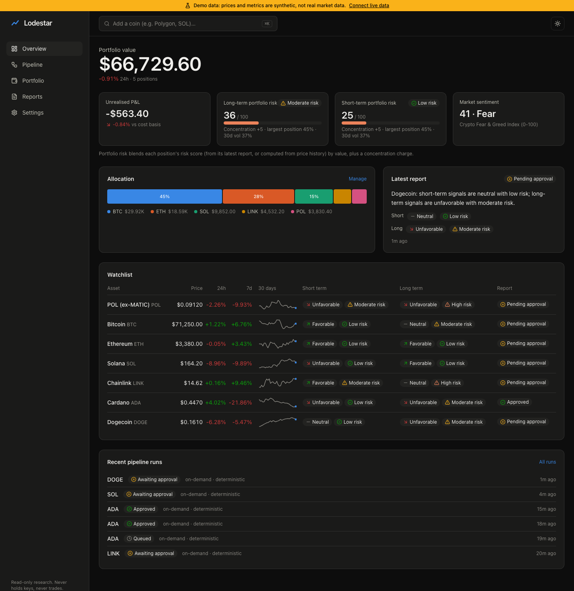

# UI design

Dark-first, data-dense, calm. Data is the only loud thing on screen. Built with React 19, TanStack Query, Tailwind v4 and TradingView Lightweight Charts.

## Screens

| Screen | Content |
|---|---|
| **Overview** | Hero portfolio value + 24h change → KPI row (unrealised P&L, long-term and short-term portfolio risk meters, Fear & Greed) → allocation (tall segmented bar, ≤ 6 parts) and latest report → watchlist (price, 24h, 7d, 30-day sparkline, stance + risk per horizon, report status) → recent runs |
| **Coin detail** | Header (price, Watch, Run analysis / Run in progress) → stat tiles → candles (exchange OHLC) with SMA 20/50/200 and Bollinger toggles, a legend carrying live values, RSI panel below → approval bar → headline with exports and verification summary → short-term and long-term cards (signal score, risk level + score, "how this was computed", tagged claims) → portfolio, data quality (per-source price comparison), assumptions → evidence bundle (cited / all, kind, source, lineage) → disclaimer |
| **Pipeline** | Run list → selected run: status, Live indicator, Data step, the four analysts side by side ("run in parallel"), Portfolio, Report writer and Verifier (with every attempt and the findings that triggered a repair), Human approval → the verified report with Approve / Reject |
| **Portfolio** | Value, cost, P&L tiles → thin allocation bar above a positions table with per-source lots → three import cards: manual, CSV (file or paste, line-numbered errors), public address (with the "never a private key" warning) |
| **Reports** | Filters (daily / on-demand, status) → list with headline, stances and risk levels → detail page = the report view with exports |
| **Scanner** | Universe (top-N by market cap or watchlist) and Run scan → live progress meter → ranked table: score bar, trend points, distance from the 20-day high, volume ratio, strength vs BTC, 24h volume with a Liquid/Thin label, setup badge, star on the shortlist, **Build trade plan** (opens the run) |
| **Pipeline (trade plan)** | Same timeline with five skills side by side, then Timing agent, Scenario stats engine (with a small-sample warning note), Risk and position sizer, Backtester, Report writer, Verifier, Human approval → the verified trade-plan card |
| **Trade-plan card** | Approval bar → headline with setup, risk and "Paper trading only" badges, exports, verification, **Paper trade this plan** (enabled once approved) → price ladder (invalidation, entry zone, trigger, last close, profit rule) with the levels table → size from max loss (binding limit, slippage, risk meter) → bull/base/bear table with case counts, frequency and its 95% interval bar, mean, median, worst drawdown and a reliability badge → backtest metrics and warnings → tagged claim sections → evidence → disclaimer |
| **Backtests** | Run form (coin, setup) → history table → detail: KPI tiles, warnings, out-of-sample equity vs buy and hold (both indexed to 100, one axis), IS/OOS/walk-forward metrics, folds, trades, assumptions |
| **Paper trading** | "Simulated money only" explainer with Process new bars / Demo replay / Reset → KPI tiles (equity, return vs BTC, realised P&L, win rate, drawdown, cash) → equity vs Bitcoin buy-and-hold → active and closed positions with status, levels, P&L after fees and origin (Plan link or "Demo replay") |
| **Settings** | Data mode and provider status, agent mode and pipeline limits, preferences (Polymarket, mismatch tolerance), trading preferences (paper only), theme, access mode |

A persistent amber **"Demo data"** banner sits above every screen whenever demo mode is on.

## Rules applied

- **Claim types are visible.** Every sentence carries a `FACT` / `CALCULATION` / `INTERPRETATION` / `SCENARIO` / `ASSUMPTION` badge and evidence-id chips (`DAT-01`, `TEC-04`). Hover or focus a chip to see the metric, value and source.
- **Status never relies on color alone.** Stance and risk badges pair a status color with an icon and a text label.
- **Charts:** up/down candles use the diverging blue/red pair (polarity), not the reserved status colours. SMA overlays take categorical slots 2-4 in fixed order; Bollinger bands are recessive dashed lines. RSI is its own panel on a fixed 0-100 scale, never a second y-axis. The legend carries each overlay's live value as text, which is also the contrast relief the palette validator requires in light mode. Allocation is a segmented bar, never a donut; sparklines use the de-emphasis hue with the latest point in the accent.
- **Trading views:** timing is shown as levels and conditions, never as a moment; every rate sits next to its sample size and interval; a small or insufficient sample gets an amber or red badge with an icon and words; comparison charts put both lines on one axis and unit (indexed to 100, or USD from the same starting cash) with a legend and crosshair readout.
- **Palette:** series and status colors come from a validated categorical palette (CVD-separation and contrast checked in both modes). Light mode uses its own selected steps rather than an inversion.
- **Numbers:** prices keep four significant digits below $1 ($0.08767); tables use tabular figures; big values compact ($933.04M).
- **Loading:** range changes keep the previous chart frame at reduced opacity (no skeleton flash); pipeline runs update live over SSE.
- **Accessibility:** keyboard-navigable search (↑ ↓ Enter, ⌘K), visible focus rings, `role="meter"` with values, aria labels on charts and icon buttons.
